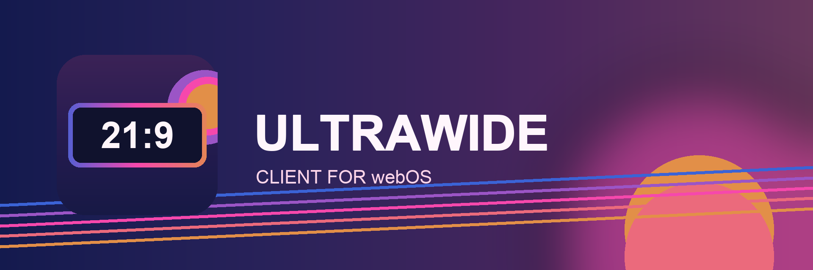

# Ultrawide Client for webOS



An **unofficial** webOS client for Jellyfin servers, adapted from the [official Jellyfin webOS client](https://github.com/jellyfin/jellyfin-webos). It wraps the web interface served by your Jellyfin server, so your library, metadata, and playback history stay in Jellyfin.

The app targets 3440×1440 ultrawide displays. Its own app ID lets it coexist with the official client. It is not affiliated with or endorsed by Jellyfin.

## Video controls

- **Auto** preserves the full frame. A 16:9 video has side bars on a 21:9 display.
- **Zoom** fills the screen and crops the excess picture.
- **Stretch** fills the screen by changing the picture's proportions.
- During playback, **red** cycles between the Jellyfin menu setting, forced cover, and forced contain. **Green** zooms out 5%, **yellow** zooms in 5%, and **blue** resets to 100%. The adjustable zoom range is 100–200%.

See [ULTRAWIDE.md](ULTRAWIDE.md) for implementation details and the device checks.

## Build and install

Install Node.js and the [webOS CLI](https://webostv.developer.lge.com/develop/tools/cli-installation), then enable Developer Mode on your TV and register it with the CLI. The commands below assume the device alias is `tv`.

```sh
npm ci
npm run check
npm run package
ares-install --device tv build/com.antoine.ultrawideclient_1.2.2_all.ipk
ares-launch --device tv com.antoine.ultrawideclient
```

Connect to your Jellyfin server in the app. The app does not include server credentials, local device keys, or a bundled media library.

To regenerate the artwork, install Pillow and run `python3 tools/gen-branding.py`. The colors are `#3b63d6`, `#9b55c6`, `#f648ac`, `#eb6a7c`, and `#e28f48`.

## License and attribution

Source code is available under [MPL 2.0](LICENSE). The original webOS client is © its [Jellyfin contributors](https://github.com/jellyfin/jellyfin-webos/graphs/contributors); this fork preserves its source notices. Portions inherited from upstream may be under Apache 2.0 as indicated in their files. The current icon, banner, and splash artwork were created for this fork and are included under MPL 2.0. “Jellyfin” is a trademark of the Jellyfin Project; it is used here only to identify server compatibility.
